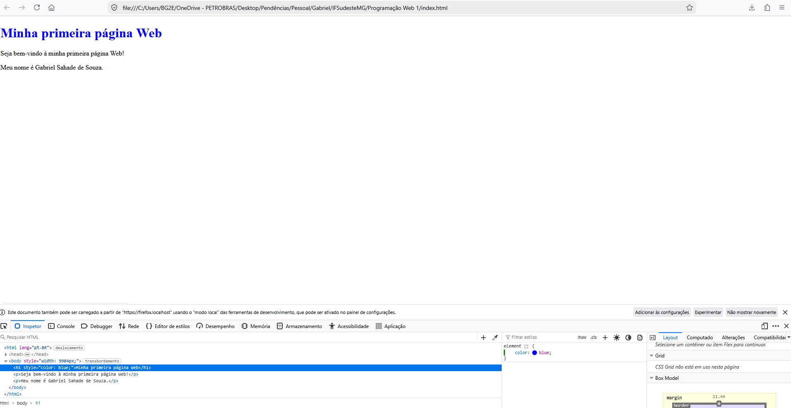
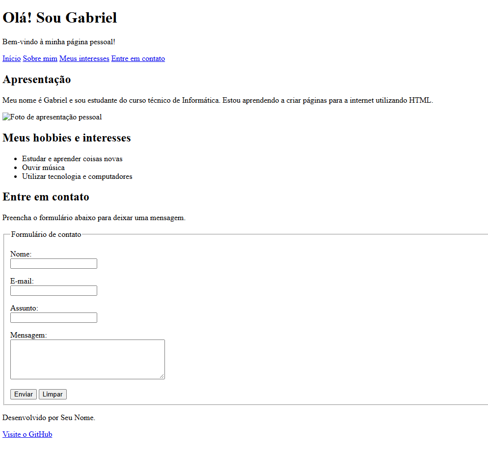

# Minha primeira página Web

Nome: Gabriel Sahade de Souza

## Sobre a atividade

Esta é minha primeira página desenvolvida na disciplina
Programação Web.

## Tecnologias utilizadas

- HTML
- Git
- GitHub

## Captura de tela

## Formulário de contato

A página pessoal possui um formulário HTML com
campos para nome, e-mail, assunto e mensagem.

### Captura de tela

